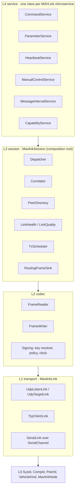
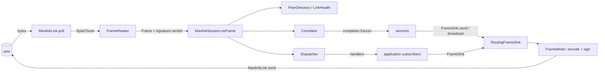

# Architecture

The library is five layers. A layer depends only on the layers below it and never reaches two levels
down; L0 and `config` are universal. The rule is enforced by an ArchUnit test.

## Data path

Receive: bytes become a `Frame` in `FrameReader` (resync, decode, signature verdict). For each frame
`MavlinkSession` updates the peer directory and link health, offers it to the `Correlator` first (so a
waiter never misses its reply behind a slow handler) and then to the `Dispatcher`.

Send: services hold a `FrameSink`, never the session. `RoutingFrameSink` resolves a `PeerId` to the link
and address the peer was last heard on (a `PeerUnreachableException` if it never was); `FrameWriter`
encodes and, when a key is known, signs.

## Layer responsibilities

| Layer | Owns | Does not know |
|---|---|---|
| L0 | identity value types | everything else |
| L1 transport | moving bytes over one connection | frames, MAVLink |
| L2 codec | bytes to `Frame` and back, MAVLink 2 signing | sessions, retries |
| L3 session | reader threads, peer table, dispatch, correlation, TX scheduling | microservice semantics |
| L4 service | retries, timeouts and result classification per MAVLink microservice | which concrete session or link |

Message payloads are the generated `io.dronefleet.mavlink` classes, carried as `Object` inside `Frame`
(`Frame.is` / `Frame.as` avoid raw casts). Only `codec` and `session` touch that library.

See also [threading](threading.md), [signing](signing.md), [transports](transports.md),
[testing](testing.md).
