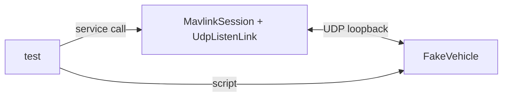

# Testing

Tests prefer real loopback over mocks, and never sleep on real time when a clock can be injected.

## Deterministic time

`MavlinkSettings.builder().clock(InstantSource)` is the only time source the library reads (frame
receive stamps, peer liveness, signing windows, command deadlines measured against it). A small manual
`InstantSource` (the testkit's `ManualInstantSource`) whose `instant()` you advance by hand makes timestamp- and window-driven logic exact:

```java
var settings = MavlinkSettings.builder().clock(manualClock).build();
manualClock.advance(Duration.ofSeconds(5));
```

`callbackExecutor` defaults to direct, so a future completes on the calling thread of the reader and
tests need no executor hand-off. Timers still run on the session's `TxScheduler`; tests that need
real retry timing use short `commandTimeout` / `commandRetries` in settings.

## The testkit

`mavlink4j-testkit` (package `io.mavlink4j.testkit`, depends on `mavlink4j-core` only) is the public set of
test doubles for code that talks MAVLink through this library. Add it with `test` scope.

| Class | What it gives you |
|---|---|
| `FakeVehicle` | A scripted aircraft over real UDP loopback; heartbeats every 200 ms, records received frames, answers by script or by hand |
| `RecordingLink` | A `MavlinkLink` that records every `send` and returns whatever you `inject` from `poll` |
| `LoopbackLinkPair(boundaries)` | Two in-memory links back to back; `true` = one send is one chunk, `false` = a byte stream you can slice with `streamChunkBytes` |
| `ManualInstantSource` | An `InstantSource` that moves only on `advance`/`set` |
| `DirectTxScheduler` | A `TxScheduler` with no threads: `submit` runs inline, `repeat` tasks run on `tick()` |

### FakeVehicle

```java
try (FakeVehicle vehicle = FakeVehicle.builder("127.0.0.1", port)
        .sysid(21)
        .onCommand(MavCmd.MAV_CMD_COMPONENT_ARM_DISARM, CommandReply.ack(MavResult.MAV_RESULT_ACCEPTED))
        .parameter("WPNAV_SPEED", 500f, MavParamType.MAV_PARAM_TYPE_REAL32)
        .signedWith(key32)            // optional: sign what it sends, verify what it receives
        .build()) {
    // drive the system under test; vehicle.awaitFrame(CommandLong.class, timeout) to assert on it
}
```

- `onCommand(MavCmd, CommandReply)` &mdash; `CommandReply.ack(result)`, `inProgressThen(progress, result)`,
  `silent()`, or a lambda. An unscripted command is recorded and not answered, which is how you exercise a
  timeout and retry. Callable after `build()` too.
- `parameter(name, value, type)` &mdash; the vehicle then answers `PARAM_REQUEST_READ` (by name or index),
  `PARAM_REQUEST_LIST` and `PARAM_SET` (which changes the stored value and echoes it). An unknown name gets
  no reply, as on a real autopilot.
- `signedWith(key)` &mdash; builder only, because the codec's signing is fixed at construction.
- `replyAck`, `replyAckInProgress`, `replyParamValue`, `replyAutopilotVersion` &mdash; one reply by hand, for
  cases a script cannot express (a different parameter than asked, an out-of-order ack).
- `relocate()` rebinds the vehicle to a new source port to prove a reply follows the peer to its new address.



### LoopbackLinkPair: the link hinge, both ways

`MavlinkLink.preservesMessageBoundaries()` must never be read as "one poll is one message". Build the pair
once with `true` and once with `false` (`new LoopbackLinkPair(false, 3)` forces a frame to arrive three
bytes at a time) and assert the same frames come out of `FrameReader` either way. `LoopbackLinkPairTest`
does this in both directions (`a` to `b` and `b` to `a`).

The testkit depends on core, so core's own tests cannot depend on it (a reactor cycle). Core keeps its own
private copies of `FakeVehicle` and `RecordingLink` under `src/test`; everything new should use the testkit.

## What each tier covers

| Tier | Example |
|---|---|
| Codec round trip | `FrameWriterFrameReaderRoundTripTest`, `SignedRoundTripTest` |
| Transport | `UdpLoopbackTest`, `TcpClientLinkTest`, `SerialLinkTest` |
| Serial over a pty | `SerialLinkSocatIntegrationTest`, gated with `assumeTrue(socat on PATH)`; skipped cleanly when absent |
| Session | `MultiPeerLoopbackTest`, `TargetedSendAddressesTheRightPeerTest` |
| Services | `CommandServiceTest`, `ParameterServiceTest` against `FakeVehicle`; the testkit's own `FakeVehicleTest` |

Gate tests on external prerequisites with `assumeTrue` so they skip, never fail.

## A test is evidence only once it can fail

Break the production code on purpose and confirm the test fails at the claimed assertion before
trusting it.
