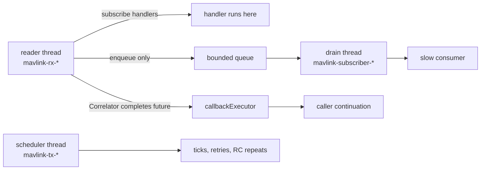

# Threading

The library starts three kinds of threads, all through `MavlinkSettings.threadFactory()` (named for
their job and marked daemon so a leaked thread never keeps the host JVM alive). It reads time only from
`MavlinkSettings.clock()`.

| Thread | Name | Started by | Runs |
|---|---|---|---|
| Reader, one per link | `mavlink-rx-<linkId>` | `MavlinkSession.addLink` | `MavlinkLink.poll` loop, `FrameReader`, `onFrame`, `Correlator.offer`, synchronous `Dispatcher` handlers |
| TX scheduler pool | `mavlink-tx-<n>` | `MavlinkSession` (one `TxScheduler`, sized by `txPoolSize`) | heartbeat ticks, manual-control repeats, one-shot sends, retry timers |
| Async subscriber drain, one per `subscribeAsync` | `mavlink-subscriber-<name>` | `Dispatcher.subscribeAsync` | the slow downstream consumer |

## What runs where

- **`Dispatcher.subscribe` handlers run on the reader thread.** They must be fast and non-blocking; a
  handler that throws is logged and isolated from the others.
- **`Dispatcher.subscribeAsync`** only enqueues on the reader thread. A dedicated thread drains a bounded
  queue, dropping the **oldest** frame when full (newest data wins); `droppedCount()` reports the loss.
- **Futures** returned by services (`CompletableFuture<CommandResult>` and friends) are completed on
  `MavlinkSettings.callbackExecutor()`. The default is direct (`Runnable::run`), i.e. the reader
  thread: a continuation attached with `thenApply` runs there. Pass an executor to move continuations
  off the reader thread. Never block the reader thread waiting on another future of the same session.
- **Timers** (retries, deadlines, heartbeat, RC repeat) run on the session's single `TxScheduler`;
  services take it from `MavlinkSession.scheduler()` and never create pools of their own. The session
  closes it; do not close it yourself.
- **Sends are thread-safe.** `MavlinkLink.send`, `FrameSink` and the services may be called from any
  thread; `MavlinkLink.poll` is driven by exactly one reader thread.
- **`MavlinkSession.addLink` / `removeLink` / `close`** are serialized by one monitor; `close()` is
  idempotent and joins reader threads bounded by `closeJoinTimeout`. A reader never blocks forever:
  `poll` is called with `pollTimeout`, so a silent link still lets `close` return.

## Ownership

The session does not own the links you register: open and close them yourself. `removeLink` and `close`
stop processing a link without closing it.

## Time

No `Instant.now()`, `new Thread` or `Executors.*` exists outside `MavlinkSettings` defaults. Inject a
manual `InstantSource` and a direct `callbackExecutor` to make tests deterministic ([testing](testing.md)).
