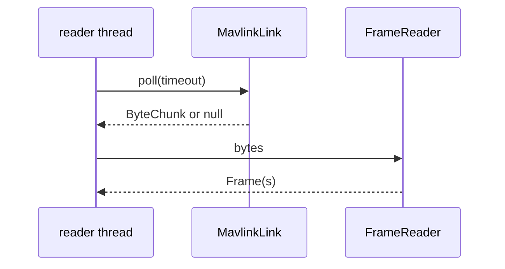

# Transports

A transport is a `MavlinkLink`: bytes in, bytes out, knowing nothing about frames.

| Link | Direction | URI-style semantics |
|---|---|---|
| `UdpListenLink(bindHost, bindPort)` | **listens**: binds locally, learns peers from inbound datagrams | the address is the local bind address. This is how radios and SITL push at you |
| `UdpTargetLink(host, port)` | **dials**: fixed remote destination | the address is the remote endpoint; replies come back to the same socket |
| `TcpClientLink(host, port, connectTimeout)` | **dials** a TCP server | stream: a poll may return a partial frame, several, or one split across polls |
| `SerialLink(SerialChannel)` | local device | the bytes come from a `SerialChannel`; `SerialLinks.open(port, baud)` (artifact `mavlink-serial`) uses jSerialComm |

`defaultTarget()` is "whoever transmitted most recently" on a listen link, so on a shared port it is
**not** a routing key. Use `FrameWriter.sendTo` / `RoutingFrameSink` (which route by `PeerId` to the
address that peer was last heard on) for any targeted message such as ARM.

`UdpListenLink.intake()` exposes datagram and byte counters taken before parsing: a dead UDP port never
errors on its own, this is the only honest signal that nothing arrives.

## Writing your own link

Implement `MavlinkLink`:

- `id()` stable for the link's life.
- `preservesMessageBoundaries()`: `true` only for datagram-shaped links. It is a hint for how many
  resync buffers `FrameReader` keeps, never a promise that one poll equals one frame.
- `poll(Duration)`: returns `null` on timeout **or** after close, throws `IOException` only on genuine
  failure; one thread drives it. A returned `ByteChunk` is not overwritten by the link afterwards;
  copy bytes you keep (`ByteChunk` is zero-copy on purpose).
- `send(...)`: thread-safe; `IllegalArgumentException` for a target with no address.
- `close()`: idempotent; unblocks a pending `poll`.

## Serial

`SerialLink` delegates to a `SerialChannel` (`read` with an explicit timeout, `write`, `close`). Plug in
any backend by implementing it; the jSerialComm one is `SerialLinks.open` in `mavlink-serial`. A device that disappears
mid-read is reported through `MavlinkSession.onLinkFailure` (a genuine failure, not a timeout or a
requested close), so the host can reopen it.

## Lossy links

UDP drops and reorders. Services report honest outcomes: a command with no reply ends as `NO_ACK` after
its retries, never as a guessed success.
